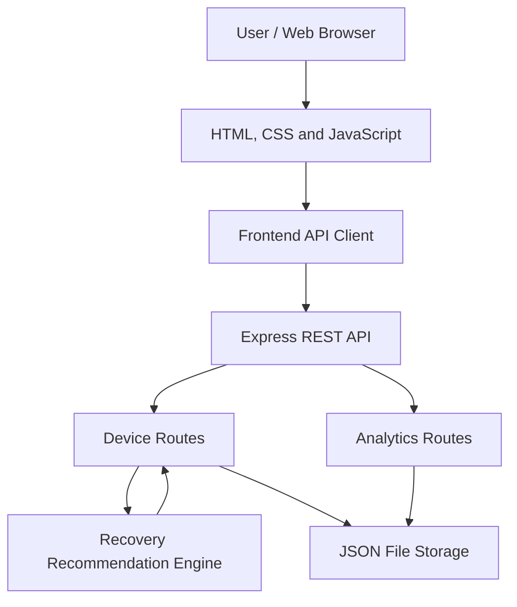

# LoopLedger — System Architecture

## 1. Overview

LoopLedger uses a lightweight client-server architecture. The browser provides the dashboard, while a Node.js and Express server manages inventory records, calculates recovery recommendations, and returns analytics.

## 2. Architecture Diagram

## 3. Components

### Frontend

Located in `public/`.

- `index.html` defines the dashboard layout and interface.
- `css/style.css` provides responsive styling and theme support.
- `js/api.js` centralizes HTTP requests to the backend.
- `js/app.js` handles navigation, inventory interactions, forms, filtering, and CSV export.
- `js/charts.js` renders dashboard visualizations using Chart.js.

### Backend

Located in `server.js` and `src/`.

- `server.js` configures Express, security headers, static files, and API routes.
- `src/routes/devices.js` provides device inventory CRUD operations and filtering.
- `src/routes/analytics.js` calculates dashboard summaries.
- `src/utils/recoveryEngine.js` evaluates device attributes and recommends potential recovery actions.
- `src/middleware/errorHandler.js` returns consistent API error responses.

### Data Storage

`data/devices.json` stores the device records. The server reads and writes this file when inventory changes.

This storage approach is suitable for a small prototype. A production system should use a database with transaction support and appropriate access controls.

## 4. Request Flow

1. A user opens the dashboard.
2. Frontend JavaScript requests inventory and analytics from the API.
3. Express routes validate requests and access the stored records.
4. The recovery engine evaluates device attributes where required.
5. The API returns JSON responses.
6. The frontend updates tables, metrics, and charts without reloading the page.

## 5. Recovery Recommendation Flow

The recommendation engine applies predefined rules to recorded device characteristics. It returns a suggested recovery action and associated illustrative estimates.

The engine is rule-based, not a trained machine-learning model. Recommendations should be reviewed before operational decisions are made.

## 6. Security and Limitations

The prototype uses Helmet for HTTP security headers and validates inventory inputs on the server.

It does not yet provide user authentication, role-based authorization, a production database, or a complete audit trail. The demo reset endpoint is intended for demonstration purposes and must be protected before deployment in a real organization.

## 7. Potential Production Architecture

A future version could use PostgreSQL, authenticated API access, role-based permissions, structured audit logs, automated testing, and a deployment pipeline. Environmental impact calculations should use documented and independently verifiable factors.